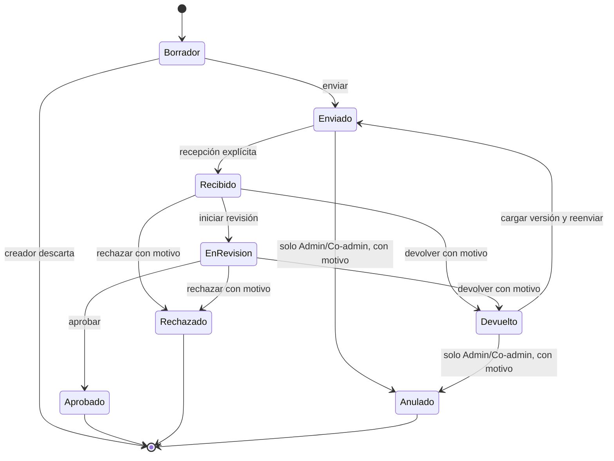

# Flujo documental conceptual

## 1. Estados

Se añade `borrador` como estado técnico necesario antes del envío. Los estados institucionales solicitados se mantienen.

| Estado | Significado | ¿Terminal? |
|---|---|---|
| Borrador | Aún editable, sin código oficial, no visible para destinos y sin notificaciones. | No |
| Enviado | Distribuido, pendiente de recepción. | No |
| Recibido | Un usuario del destino aceptó formalmente la recepción. | No |
| En revisión | Existe responsable procesándolo. | No |
| Aprobado | Revisión concluida satisfactoriamente. | Sí para esa entrega/destino |
| Devuelto | Requiere corrección y una versión posterior. | No |
| Rechazado | El destino cerró negativamente el trámite. | Sí |
| Anulado | El emisor/autoridad invalidó el trámite con motivo. | Sí |

## 2. Diagrama de transición por destinatario

No existen transiciones directas desde Enviado a Aprobado. Se conserva recepción y revisión para que la trazabilidad sea completa. Descartar un borrador no equivale a anular: únicamente elimina trabajo aún no oficial. Después del envío no existe eliminación normal.

## 3. Flujo de creación y envío

Implementado en la Fase 11 mediante `DocumentWorkflowService` y una única transacción PostgreSQL.

1. El usuario autorizado crea un borrador con tipo, asunto, origen, prioridad, confidencialidad y fecha límite opcional. Todavía no recibe código oficial ni genera notificaciones.
2. Agrega uno o varios destinatarios normalizados en estado `prepared`. Cada destino indica si requiere respuesta o es copia informativa. Prepararlos no equivale a enviar.
3. Adjunta uno o más archivos privados que comparten la versión inicial 1. Mientras continúe en borrador puede agregar o retirar archivos sin dejar una versión vacía.
4. La aplicación valida extensión, MIME detectado por el servidor, estructura, tamaño, nombre y permisos; registra SHA-256 y guarda con nombre UUID fuera del directorio público.
5. La pantalla de revisión muestra un resumen comprensible.
6. Al confirmar, una transacción bloquea/genera correlativo, asigna el código oficial, cambia los destinatarios preparados a `sent` y crea el evento de envío.
7. Después del commit, el evento de dominio resuelve destinatarios activos, elimina duplicados y guarda las notificaciones internas.

Si falla una parte esencial, el documento no queda parcialmente enviado.

## 4. Flujo de recepción y revisión

Implementado en la Fase 11 con recepción explícita y autorización combinada de RBAC, Policy y participación en el destinatario.

1. El destino ve el documento en Recibidos.
2. Un usuario autorizado pulsa **Recibir documento**. Se guarda quién y cuándo; solo abrir la pantalla no constituye recepción.
3. Jefe/Secretaria o Auxiliar asignado inicia revisión.
4. Auxiliar puede registrar revisión y recomendación, pero no decisión final.
5. Jefe, delegado o Secretaria con permiso decide aprobar, devolver o rechazar.
6. La decisión actualiza el destinatario bajo bloqueo, agrega evento inmutable y recalcula el estado general. Después del commit se notifica al creador/remitente y, en decisiones finales, a Jefe y Secretaria activos del origen.

## 5. Devolución y nueva versión

1. Devolver exige motivo visible para el origen.
2. El documento queda en Devuelto; versiones anteriores permanecen intactas.
3. Un usuario autorizado del origen prepara una nueva versión completa; el documento continúa Devuelto.
4. Al enviar la corrección, solo los destinatarios formales devueltos regresan a Enviado y se limpian sus campos operativos para el nuevo ciclo.
5. Destinatarios aprobados y copias informativas conservan su estado; el estado general se recalcula sin consumir un correlativo nuevo.
6. Reenviar conserva el código del documento y registra los eventos de versión creada y corrección enviada.
7. No se borra ni sobrescribe el archivo devuelto.

## 6. Rechazo

- Requiere motivo obligatorio.
- Cierra el destino correspondiente.
- Con el orden de precedencia aprobado, el estado general queda Rechazado si cualquier destinatario obligatorio rechaza.
- Reabrir un rechazo no forma parte del flujo ordinario. Si la institución lo necesita, deberá ser una acción administrativa excepcional auditada.

Las respuestas ya emitidas por otros destinatarios permanecen intactas cuando se registra un rechazo o una devolución.

## 7. Estado general con múltiples destinos

Orden de precedencia aprobado:

1. `annulled` si el documento fue anulado.
2. `rejected` si algún destinatario obligatorio rechazó.
3. `returned` si algún destinatario obligatorio devolvió y no existe rechazo.
4. `approved` si todos los destinatarios obligatorios aprobaron.
5. `in_review` si alguno está en revisión.
6. `received` si alguno recibió.
7. `sent` en el resto de destinos enviados.
8. `draft` antes del envío.

Los destinos informativos no bloquean la aprobación general, aunque registran recepción y descarga.

La implementación añade una precisión para documentos compuestos solo por copias: quedan `received` cuando alguna copia fue recibida y no alcanzan `approved` por una condición vacía.

## 8. Concurrencia

- Cada decisión incluye la versión de bloqueo recibida por la pantalla.
- El servicio relee y bloquea la fila antes de cambiarla.
- Si otra persona ya decidió, se cancela la segunda acción y se muestra: “El documento cambió mientras lo revisaba. Actualice la página para ver su estado actual.”
- Los eventos se crean dentro de la transacción de la decisión; las notificaciones se despachan después de su commit.

La Fase 11 implementa el bloqueo de documento y destinatario y el control doble de `lock_version`. La Fase 12 agrega el evento dentro de esa misma transacción mediante `DocumentEventService`. La Fase 14 escucha un evento de dominio `ShouldDispatchAfterCommit`: no existe aviso previo al commit ni aviso residual ante rollback.

## 9. Motivos obligatorios

| Acción | Motivo |
|---|---|
| Aprobar | Opcional |
| Devolver | Obligatorio |
| Rechazar | Obligatorio |
| Anular | Obligatorio |
| Revocar acceso | Obligatorio |
| Revocar delegación | Obligatorio |

La validación ocurre en Form Request y nuevamente en el servicio de dominio para que ninguna entrada alternativa omita la regla.

La anulación posterior al envío solo está autorizada para Administrador y Co-administrador. Jefe y Secretaria conservan aprobación, devolución y rechazo en su ámbito, pero no anulación.

## 10. Eventos mínimos de historial

- documento creado;
- destinatario agregado/retirado antes de enviar;
- versión y archivo agregados;
- documento enviado/reenviado;
- recibido por destino;
- revisión iniciada;
- revisión auxiliar completada;
- observación agregada;
- aprobado/devuelto/rechazado/anulado;
- acceso confidencial concedido/revocado;
- archivo descargado cuando la política lo requiera.

El descarte de un borrador utiliza eliminación lógica y registra `draft_discarded`; así conserva su historial sin convertirlo en documento oficial. La auditoría transversal continúa separada.

La interfaz presenta estos eventos como línea de tiempo, más reciente primero y paginada. Los eventos anteriores al envío se identifican como preparación y los posteriores como oficiales. Las lecturas simples no generan historial.

## 11. Condición de vencimiento

El vencimiento es una condición calculada y nunca una transición de `DocumentStatus`:

- sin fecha: `due_at` es nulo;
- vigente: fecha futura fuera del umbral;
- próximo a vencer: fecha futura dentro de los días calendario configurados;
- vencido: `due_at` ya pasó y todavía existe actuación pendiente;
- no aplicable: borrador o trámite terminal.

Los estados operativos son `sent`, `received`, `in_review` y `returned`. En los tres primeros, la responsabilidad permanece en el destino formal y su responsable actual. En `returned`, pasa al creador/remitente y a Jefe/Secretaria activos del origen para preparar la corrección. Al vencer también se informa al creador/remitente cuando el destino continúa pendiente.

El comando `documents:process-deadlines` consulta por SQL solo documentos dentro de un hito, bloquea cada fila, resuelve usuarios activos y genera como máximo un aviso por usuario e hito. La corrección no reinicia `due_at`.

## 12. Validación de cierre

La Fase 24 validó de extremo a extremo el ciclo borrador → envío → recepción → revisión → devolución → versión corregida → reenvío → aprobación. También validó el caso multidestino donde A y C conservan su aprobación mientras únicamente B reingresa al flujo tras devolver el documento.

Los escenarios de copia informativa, rechazo, anulación, confidencialidad, grants, delegación, vencimientos y concurrencia permanecen cubiertos por la matriz `PRUEBAS_ACEPTACION.md`. Estas pruebas no alteran el modelo de estados aprobado.

