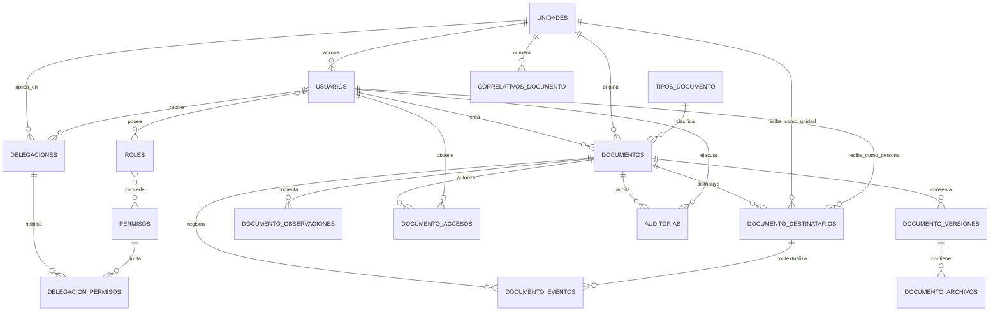

# Modelo de datos inicial

Este diseño lógico fue convertido a migraciones y validado sobre PostgreSQL 18.3 durante la Fase 2. Los nombres físicos siguen convenciones Laravel en inglés; este documento conserva nombres funcionales en español para facilitar su revisión institucional.

## 1. Diagrama entidad-relación conceptual

## 2. Identidad, organización y acceso

### `organizational_units` (`unidades`)

| Campo | Tipo conceptual | Regla |
|---|---|---|
| `id` | bigint | PK interna. |
| `public_id` | uuid | Único; se usa en URLs. |
| `parent_id` | FK nullable | Nulo para Facultad; carreras y Kardex dependen de la Facultad. |
| `type` | string/enum | `faculty`, `career`, `kardex`. |
| `name` | varchar(160) | Obligatorio. |
| `acronym` | varchar(20) | Único, normalizado en mayúsculas. |
| `description` | text nullable | Descripción institucional. |
| `is_active` | boolean | Índice para listados. |
| `created_at`, `updated_at` | timestamptz | Trazabilidad. |
| `deleted_at` | timestamptz nullable | Descarte lógico exclusivo de borradores nunca enviados. |

Restricciones: un solo registro de tipo `faculty`; un solo registro de tipo `kardex`; nombres y siglas únicos sin distinguir mayúsculas; las carreras y Kardex requieren una Facultad como padre; la FK restringe eliminar una unidad con descendientes. Las carreras se agregan sin modificar código y el modelo expone scopes para carreras, unidades activas y destinos futuros disponibles.

### `users`

| Campo | Tipo conceptual | Regla |
|---|---|---|
| `id` | bigint | PK. |
| `public_id` | uuid | Único para URLs. |
| `organizational_unit_id` | FK nullable | Nulo para ámbito global; requerido para roles de unidad. |
| `name` | varchar(255) | Nombre completo. |
| `email` | varchar(255) | Único sin distinguir mayúsculas, normalizado en minúsculas. |
| `password` | varchar | Hash, nunca auditable. |
| `status` | string/enum | `active`, `inactive`. |
| `email_verified_at` | timestamptz nullable | Preparado para verificación futura. |
| `last_login_at` | timestamptz nullable | Información de seguridad. |
| `remember_token` | varchar nullable | Convención Laravel. |
| `created_at`, `updated_at` | timestamptz | Trazabilidad. |

No se borran usuarios que participaron en trámites. El estado inactivo bloquea autenticación y conserva relaciones históricas. Administrador y Co-administrador tienen unidad nula; Jefe, Secretaria, Auxiliar y Extra requieren una carrera activa. La aplicación impide más de un Jefe principal activo por carrera mediante una transacción que bloquea la unidad.

### RBAC (`roles`, `permissions` y pivotes)

Se usarán las tablas convencionales del paquete de permisos elegido en Fase 4: `roles`, `permissions`, `model_has_roles`, `model_has_permissions`, `role_has_permissions`. Los nombres de permisos serán acciones estables como `documents.approve`, no textos de interfaz.

### `temporary_delegations`

| Campo | Tipo conceptual | Regla |
|---|---|---|
| `id` | bigint | PK. |
| `delegator_user_id` | FK users | Jefe titular activo cuya autoridad se delega; `RESTRICT`. |
| `delegate_user_id` | FK users | Usuario delegado. |
| `organizational_unit_id` | FK units | Debe ser carrera. |
| `authorized_by` | FK users | Actor autorizador. |
| `starts_at`, `ends_at` | timestamptz | `ends_at > starts_at`. |
| `reason` | text | Obligatorio. |
| `status` | enum | `scheduled`, `active`, `revoked`, `expired`. |
| `revoked_by`, `revoked_at`, `revocation_reason` | nullable | Revocación auditable. |
| `created_at`, `updated_at` | timestamptz | Trazabilidad. |

Índices: delegado+fechas, unidad+fechas y estado. La autorización efectiva exige intervalo vigente y no revocado; no depende de que un job cambie el estado a tiempo.

### `temporary_delegation_permissions`

Campos: `temporary_delegation_id`, `permission_id`, `created_at`. La clave primaria compuesta evita permisos duplicados y ambas FKs usan `RESTRICT`. Esta tabla concede únicamente las capacidades seleccionadas de un catálogo cerrado de Jefatura. No asigna roles ni permisos directos de Spatie; las Policies consultan la delegación efectiva con ámbito de carrera.

## 3. Catálogos documentales

### `document_types`

Campos: `id`, `public_id`, `name`, `code` único y estable, `description` nullable, `is_active`, `created_by`, timestamps. Nombre y código son únicos sin distinguir mayúsculas en PostgreSQL. El código se genera al crear y permanece estable aunque se edite el nombre. Desactivar no rompe documentos históricos; el scope `availableForNewDocuments` excluye los registros inactivos de operaciones nuevas.

Los estados, prioridades y confidencialidad iniciales se implementarán como Enums PHP con cadenas en la base, no como catálogos editables, porque gobiernan lógica estable. Si la institución necesita flujos configurables en el futuro, se hará una migración deliberada.

## 4. Núcleo documental

### `documents`

| Campo | Tipo conceptual | Regla |
|---|---|---|
| `id` | bigint | PK interna. |
| `public_id` | uuid | Único para URLs y enlaces. |
| `code` | varchar(80) nullable | Único y automático al enviar; nulo mientras sea borrador. |
| `document_type_id` | FK | Tipo activo al crear; permanece referenciado si se desactiva. |
| `origin_unit_id` | FK units | Carrera/Kardex/Facultad de origen. |
| `created_by` | FK users | Autor del registro. |
| `sender_user_id` | FK users nullable | Remitente efectivo; puede permanecer nulo en borrador. |
| `subject` | varchar(255) | Obligatorio e indexable. |
| `description` | text nullable | Contenido descriptivo. |
| `general_status` | enum string | Estado agregado de bandeja. |
| `priority` | enum string | `normal`, `important`, `urgent`. |
| `confidentiality` | enum string | `normal`, `restricted`. |
| `due_at` | timestamptz nullable | Fecha límite exacta. |
| `sent_at` | timestamptz nullable | Nulo mientras sea borrador. |
| `annulled_at`, `annulled_by`, `annulment_reason` | nullable | Solo para documentos ya enviados y anulados por Admin/Co-admin. |
| `lock_version` | integer | Control de concurrencia. |
| `created_at`, `updated_at` | timestamptz | Trazabilidad. |

Índices: código único; origen+estado+fecha; tipo; estado+prioridad; vencimiento parcial; creador; remitente. Para búsqueda textual se evaluará un índice PostgreSQL `GIN` cuando existan volúmenes representativos.

La Fase 15 reutiliza `due_at` sin agregar otro campo ni un estado documental. El índice parcial `documents_due_open_index` cubre documentos con fecha y estado no terminal. La condición se calcula en `America/La_Paz`: `sent`, `received`, `in_review` y `returned` requieren actuación; `draft`, `approved`, `rejected` y `annulled` no generan una alerta activa. Una corrección no modifica la fecha límite.

Un borrador propio con `sent_at` y `code` nulos y sin dependencias operativas puede descartarse lógicamente. Queda oculto por el scope de `SoftDeletes`, mientras su fila y eventos permanecen. Una vez enviado, las restricciones impiden la eliminación ordinaria.

### `document_recipients`

| Campo | Tipo conceptual | Regla |
|---|---|---|
| `id` | bigint | PK. |
| `document_id` | FK | Documento. |
| `unit_id` | FK | Unidad destinataria. |
| `user_id` | FK nullable | Nulo para destino a unidad; presente para persona específica. |
| `requires_response` | boolean | Distingue trámite de copia informativa. |
| `status` | enum string | `prepared` durante el borrador; estados formales desde el envío. |
| `received_by`, `received_at` | nullable | Recepción explícita. |
| `current_handler_id` | FK nullable | Responsable actual. |
| `decided_by`, `decided_at` | nullable | Decisión final. |
| `decision_reason` | text nullable | Obligatorio para devolución/rechazo. |
| `lock_version` | integer | Evita cambios concurrentes obsoletos. |
| `deleted_at` | timestamptz nullable | Retiro lógico permitido únicamente en `prepared`. |
| timestamps | timestamptz | Trazabilidad. |

Restricción única por documento+unidad+usuario (tratando nulo de forma segura en PostgreSQL). Un destinatario personal conserva la relación real con su usuario y registra la unidad activa derivada del usuario durante la preparación. Jefe y Secretaria pueden ser destinos personales formales; Auxiliar únicamente copia informativa; Extra queda fuera del flujo normal y utiliza concesiones explícitas. Esta elegibilidad se valida al preparar y nuevamente al enviar. Una unidad y una persona de esa misma unidad pueden coexistir porque representan destinos distintos. La unidad de origen puede utilizarse también como destino para trámites internos.

### `document_counters`

Campos: `id`, `origin_unit_id`, `year`, `last_number`, timestamps. Restricción única `(origin_unit_id, year)`. Se actualiza con bloqueo de fila dentro de transacción.

Desde la Fase 11, el contador se crea de forma idempotente y se bloquea antes de incrementar. El código usa las siglas persistidas de Facultad y unidad, el año y un correlativo relleno inicialmente a seis dígitos. La asignación ocurre únicamente al enviar y se revierte junto con la transacción si el envío falla.

## 5. Versiones, archivos y observaciones

### `document_versions`

Campos: `id`, `document_id`, `version_number`, `uploaded_by`, `note` nullable, `created_at`. Único `(document_id, version_number)`. En la Fase 10 todos los archivos preliminares comparten la versión inicial `1`; si se retira su último archivo mientras el documento continúa en borrador, el contenedor vacío también se elimina. La Fase 13 crea versiones posteriores completas únicamente ante una devolución formal. La versión vigente se deriva con `MAX(version_number)` y las versiones ya enviadas son inmutables por el flujo ordinario.

### `document_files`

Campos: `id`, `public_id`, `document_version_id`, `disk`, `path`, `original_name`, `stored_name`, `extension`, `detected_mime_type`, `size_bytes`, `sha256`, `uploaded_by`, `created_at`.

`path` nunca se expone como URL pública. El nombre físico es un UUID y no depende del nombre proporcionado por el usuario. Índices en versión y hash. La coincidencia de hash no impide adjuntar el mismo contenido, pero ayuda a integridad y análisis. La carga y el retiro preliminar usan compensación entre filesystem y transacción de base de datos para evitar archivos huérfanos o metadatos sin archivo.

### `document_observations`

Campos: `id`, `document_id`, `recipient_id` nullable, `author_id`, `visibility` (`internal`, `participants`), `body`, `created_at`, `updated_at` nullable. Las observaciones oficiales ligadas a decisiones también quedan congeladas en el evento de estado.

### `document_access_grants`

Campos: `id`, `document_id`, `user_id`, `granted_by`, `permission` (`view`, `download`), `starts_at` nullable, `ends_at` nullable, `revoked_at` nullable, `revoked_by` nullable, `revocation_reason` nullable, `reason`, timestamps. Único lógico para concesiones activas equivalentes.

Para usuarios Extra, la concesión solo puede ser creada por Admin, Co-admin, Jefe de la unidad relacionada o Secretaria que posea el permiso de concesión en esa unidad. La vigencia se evalúa en cada consulta/descarga. Esta misma estructura soporta las autorizaciones explícitas necesarias para otros usuarios en documentos confidenciales.

## 6. Historial, auditoría y notificaciones

### `document_events`

Campos: `id` bigint secuencial, `document_id`, `recipient_id` nullable, `actor_id` nullable, `event_type`, `from_status` nullable, `to_status` nullable, `reason` nullable, `metadata` jsonb filtrado, `occurred_at` timestamptz.

Es append-only. No incluye secretos, contraseñas, rutas físicas, hashes ni contenido binario. Índices `(document_id, occurred_at, id)` y actor+fecha. La Fase 12 centraliza su escritura en `DocumentEventService`; las relaciones históricas a documentos y destinatarios retirados se resuelven explícitamente con `withTrashed()`.

### `audit_logs`

Campos: `id`, `actor_id` nullable, `action`, `auditable_type`, `auditable_id`, `ip_address` (`inet` en PostgreSQL), `user_agent` nullable, `old_values` jsonb nullable, `new_values` jsonb nullable, `request_id` uuid, `occurred_at` timestamptz.

Es append-only y visible solo con permiso de auditoría. Se aplicará una lista explícita de campos auditables para excluir credenciales y tokens.

### `notifications`

Se usa la tabla oficial de notificaciones de Laravel (`uuid`, `type`, `notifiable`, `data`, `read_at`, timestamps), sin tabla paralela. `data` conserva título, mensaje breve, `document_public_id`, código cuando no es restringido, tipo y fecha del evento, además del nombre y parámetros de una ruta relativa. Nunca guarda una URL absoluta.

La Fase 14 genera avisos del flujo desde un evento de dominio que implementa `ShouldDispatchAfterCommit`. La Fase 15 agrega recordatorios `document_due_soon` y `document_overdue` mediante el mismo canal `database`. La resolución de destinatarios admite destino personal y destino por unidad, conserva solo usuarios activos capaces de actuar y deduplica por usuario. Una notificación no participa en la autorización: abrir el enlace vuelve a ejecutar `DocumentPolicy`.

La propia fila de notificación funciona como marcador del hito. Su UUID v5 se deriva de `document_public_id + user_public_id + due_at + milestone`; la PK aporta unicidad PostgreSQL sin una tabla adicional. La creación ocurre dentro de una transacción que bloquea el documento, por lo que la notificación y el marcador son una sola escritura consistente.

Para documentos restringidos, el contenido persistido es genérico; se omiten asunto, motivo y código. El canal inicial es exclusivamente `database`, aunque las clases permanecen separadas por intención para incorporar `mail` en una fase futura.

## 7. Tareas (módulo futuro)

`tasks` y `task_assignments` quedan fuera de las primeras fases. Su diseño no condicionará las tablas documentales. Solo se crearán cuando se apruebe el módulo secundario.

## 8. Cardinalidades principales

- Unidad 1 — N usuarios.
- Usuario N — N roles.
- Rol N — N permisos.
- Unidad/usuario 1 — N delegaciones según su función.
- Delegación N — N permisos temporales.
- Unidad 1 — N documentos originados.
- Documento N — 1 tipo documental.
- Documento 1 — N destinatarios.
- Documento 1 — N versiones.
- Versión 1 — N archivos.
- Documento 1 — N eventos, observaciones y concesiones.
- Usuario 1 — N acciones de auditoría.

## 9. Integridad y concurrencia

- Todas las claves foráneas tienen índices.
- Los cambios de estado verifican `lock_version` y bloquean destinatario/documento durante la transacción.
- Crear y enviar documento guarda documento, destinatarios, versión, archivos y eventos en una unidad atómica; los archivos se preparan antes y se limpian si la transacción falla.
- El evento de notificación queda pendiente durante la transacción y su listener persiste el aviso solo después del commit exterior. Un rollback descarta tanto el cambio documental como el evento pendiente.
- Los campos de devolución, rechazo y anulación tienen constraints coherentes con estado cuando PostgreSQL permita expresarlos con claridad.
- No se usan listas separadas por comas ni IDs confiados desde el navegador.

## 10. Decisiones institucionales pendientes al cierre

1. El formato técnico de código ya está implementado; antes de cargar carreras reales deben confirmarse sus nombres y siglas oficiales.
2. Debe aprobarse una política institucional de retención, privacidad y clasificación de información personal antes de abrir producción.

