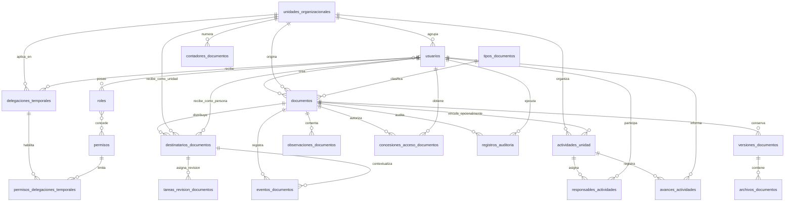

# Modelo de Datos Institucional (MySQL)

Este diseño lógico representa la estructura oficial de la base de datos del sistema, implementada y validada sobre **MySQL 8.4+ (InnoDB)** con codificación `utf8mb4` e intercolación `utf8mb4_unicode_ci`.

Todas las **tablas físicas están nombradas en español** para facilitar su identificación y administración institucional directa, manteniendo los atributos y columnas en convención estándar de Laravel para preservar la estabilidad de controladores, servicios y vistas de usuario.

---

## 1. Diagrama Entidad-Relación Conceptual

---

## 2. Catálogo Oficial de Tablas Físicas en Español

| Tabla en Español | Entidad / Modelo Eloquent | Propósito Institucional |
|---|---|---|
| `unidades_organizacionales` | `App\Models\OrganizationalUnit` | Estructura jerárquica: Facultad de Tecnología, Kardex y Carreras. |
| `usuarios` | `App\Models\User` | Cuentas institucionales de usuarios y funcionarios. |
| `roles` | `App\Models\Role` | Roles RBAC (Administrador, Jefe, Secretaria, Auxiliar, Extra, etc.). |
| `permisos` | `App\Models\Permission` | Permisos atómicos del sistema (`documents.approve`, etc.). |
| `modelo_tiene_roles` | Pivote Spatie Permission | Asignación de roles a usuarios. |
| `modelo_tiene_permisos` | Pivote Spatie Permission | Asignación directa de permisos extraordinarios. |
| `rol_tiene_permisos` | Pivote Spatie Permission | Matriz de permisos concedidos a cada rol. |
| `tipos_documentos` | `App\Models\DocumentType` | Catálogo de tipos documentales (Carta, Informe, Memorándum, etc.). |
| `contadores_documentos` | `App\Models\DocumentCounter` | Correlativos secuenciales atómicos por unidad y año. |
| `documentos` | `App\Models\Document` | Entidad principal de expedientes y trámites documentales. |
| `destinatarios_documentos` | `App\Models\DocumentRecipient` | Destinos de unidad o persona con estado y decisión independiente. |
| `tareas_revision_documentos` | `App\Models\DocumentReviewTask` | Tareas internas de revisión delegadas a secretaría o auxiliares. |
| `actividades_unidad` | `App\Models\WorkActivity` | Labores encomendadas por Jefatura, independientes o vinculadas a correspondencia. |
| `responsables_actividades` | Pivote `WorkActivity` / `User` | Responsable principal y personal de apoyo asignado a una actividad. |
| `avances_actividades` | `App\Models\ActivityUpdate` | Registro cronológico de avances informados por el personal asignado. |
| `versiones_documentos` | `App\Models\DocumentVersion` | Historial de versiones e iteraciones ante correcciones/devoluciones. |
| `archivos_documentos` | `App\Models\DocumentFile` | Metadatos y hashes de archivos adjuntos en almacenamiento privado. |
| `observaciones_documentos` | `App\Models\DocumentObservation` | Anotaciones y observaciones internas entre revisores. |
| `concesiones_acceso_documentos` | `App\Models\DocumentAccessGrant` | Permisos explícitos de lectura y descarga para usuarios Extra. |
| `eventos_documentos` | `App\Models\DocumentEvent` | Trazabilidad documental inmutable (append-only). |
| `delegaciones_temporales` | `App\Models\TemporaryDelegation` | Transferencia temporal de facultades de firma de Jefatura. |
| `permisos_delegaciones_temporales`| Pivote Delegaciones | Capacidades específicas transferidas durante la delegación. |
| `registros_auditoria` | `App\Models\AuditLog` | Auditoría de seguridad y acciones transversales del sistema. |
| `notificaciones` | `App\Models\Notification` | Bandeja de avisos y alertas transaccionales en base de datos. |
| `sesiones` | Sesiones HTTP | Almacenamiento seguro de sesiones web activas. |

---

## 3. Identidad, Organización y Acceso

### `unidades_organizacionales`
- **Campos principales:** `id` (bigint PK), `public_id` (uuid), `parent_id` (FK nullable), `type` (faculty, career, kardex), `name` (varchar 160), `acronym` (varchar 20), `description` (text nullable), `is_active` (boolean), `singleton_type` (columna virtual generada STORED), `created_at`, `updated_at`, `deleted_at`.
- **Integridad y Unicidad en MySQL:**
  - Columna virtual generada `singleton_type = (CASE WHEN type IN ('faculty', 'kardex') THEN type ELSE NULL END) STORED` con índice único para garantizar que solo pueda existir una Facultad y un Kardex en todo el sistema.
  - Triggers MySQL `unidades_parent_type_trigger_ins` y `unidades_parent_type_trigger_upd` para validar la jerarquía institucional (las Carreras y el Kardex deben descender de la Facultad).
  - Nombres y siglas únicos insensibles a mayúsculas/minúsculas.

### `usuarios`
- **Campos principales:** `id` (bigint PK), `public_id` (uuid), `organizational_unit_id` (FK nullable hacia `unidades_organizacionales`), `name` (varchar 255), `email` (varchar 255 unique), `password` (varchar hash), `status` (active, inactive), `last_login_at`, `remember_token`, timestamps.
- **Reglas:**
  - Clave foránea con `RESTRICT` para evitar la eliminación accidental de unidades con funcionarios asignados.
  - Usuarios inactivos quedan inhabilitados para inicio de sesión pero preservan la integridad histórica de sus firmas y trámites.
  - Administradores y Co-administradores tienen `organizational_unit_id = NULL` (ámbito global).

### RBAC (`roles`, `permisos`, `modelo_tiene_roles`, `modelo_tiene_permisos`, `rol_tiene_permisos`)
- Implementado mediante `spatie/laravel-permission` con tablas mapeadas al español.
- Matriz institucional con roles predefinidos: Administrador, Co-administrador, Jefe de Carrera, Encargado de Kardex, Secretaria, Auxiliar y Extra.

### `delegaciones_temporales` y `permisos_delegaciones_temporales`
- **`delegaciones_temporales`:** `id`, `public_id`, `delegator_user_id` (FK `usuarios`), `delegate_user_id` (FK `usuarios`), `organizational_unit_id` (FK `unidades_organizacionales`), `authorized_by` (FK `usuarios`), `starts_at`, `ends_at`, `reason`, `status` (scheduled, active, revoked, expired), `revoked_by`, `revoked_at`, `revocation_reason`, timestamps.
- **`permisos_delegaciones_temporales`:** `temporary_delegation_id` (FK `delegaciones_temporales`), `permission_id` (FK `permisos`), `created_at`.
- Restricciones `CHECK`: `ends_at > starts_at`, coherencia en revocación y motivo obligatorio.

---

## 4. Núcleo Documental y Trámites

### `tipos_documentos`
- **Campos:** `id`, `public_id`, `name`, `code` (varchar 50 unique), `description` (text nullable), `is_active`, `created_by` (FK `usuarios`), timestamps.
- Creados con 12 tipos base institucionales (Carta, Informe, Memorándum, Circular, Solicitud, Resolución, Nota, Formulario, Certificación, Correspondencia, Documento de Kardex, Otros).

### `contadores_documentos`
- **Campos:** `id`, `origin_unit_id` (FK `unidades_organizacionales`), `year` (smallint unsigned), `last_number` (int unsigned), timestamps.
- **Unicidad:** `UNIQUE (origin_unit_id, year)`.
- Bloqueo transaccional `lockForUpdate()` con incremento atómico para asegurar correlativos correlativos sin huecos ni colisiones.

### `documentos`
- **Campos:** `id`, `public_id` (uuid), `code` (varchar 80 nullable unique), `document_type_id` (FK `tipos_documentos`), `origin_unit_id` (FK `unidades_organizacionales`), `created_by` (FK `usuarios`), `sender_user_id` (FK `usuarios` nullable), `subject` (varchar 255), `description` (text nullable), `general_status` (draft, sent, in_review, approved, rejected, returned, annulled), `priority` (normal, important, urgent), `confidentiality` (normal, restricted), `due_at` (datetime nullable), `sent_at` (datetime nullable), `annulled_at`, `annulled_by`, `annulment_reason`, `lock_version` (int), `deleted_at`, timestamps.
- Restricciones `CHECK`: estados, prioridades, confidencialidad y consistencia de anulación.
- SoftDeletes para borradores descartados que nunca fueron enviados oficialmente.

### `destinatarios_documentos`
- **Campos:** `id`, `document_id` (FK `documentos`), `unit_id` (FK `unidades_organizacionales`), `user_id` (FK `usuarios` nullable), `requires_response` (boolean), `status` (prepared, sent, received, in_review, approved, rejected, returned), `received_by`, `received_at`, `current_handler_id`, `decided_by`, `decided_at`, `decision_reason`, `lock_version`, `target_user_id` (columna virtual generada STORED), `deleted_at`, timestamps.
- **Unicidad en MySQL:** Columna virtual generada `target_user_id = COALESCE(user_id, 0) STORED` con índice único sobre `(document_id, unit_id, target_user_id)` para impedir destinatarios duplicados sin que los valores `NULL` evadan la restricción única en MySQL.

### `tareas_revision_documentos`
- **Campos:** `id`, `public_id`, `document_recipient_id` (FK `destinatarios_documentos`), `assignment_key` (uuid), `document_version_id` (FK `versiones_documentos`), `assigned_to` (FK `usuarios`), `assigned_by` (FK `usuarios`), `instructions` (text), `recommendation` (varchar 20 nullable), `message` (text nullable), `submitted_at`, `closed_at`, timestamps.
- Restricción `CHECK`: valida que al enviarse la recomendación pertenezca a `('approve', 'reject')` y cuente con mensaje de justificación no vacío.

### `actividades_unidad`, `responsables_actividades` y `avances_actividades`
- **`actividades_unidad`:** `id`, `public_id`, `organizational_unit_id`, `document_id` opcional, `created_by`, `assigned_by`, `title`, `activity_type`, `instructions`, `expected_result`, `priority`, `status`, `due_at`, `result_summary`, `result_document_id` opcional, campos de presentación, revisión, conclusión, cancelación y `lock_version`.
- **`responsables_actividades`:** relación única entre actividad y usuario con `responsibility` igual a `primary` o `support`; una actividad conserva un responsable principal y puede incluir colaboradores.
- **`avances_actividades`:** `activity_id`, `user_id`, detalle, porcentaje estimado opcional y marcas de tiempo; no existe una ruta de edición o eliminación pública.
- Una actividad puede apuntar a un documento fuente y a un borrador resultante, pero no reemplaza los estados, autorizaciones ni el envío formal de la correspondencia.

---

## 5. Versiones, Archivos y Acceso Privado

### `versiones_documentos`
- **Campos:** `id`, `document_id` (FK `documentos`), `version_number` (int unsigned), `uploaded_by` (FK `usuarios`), `note` (text nullable), timestamps.
- **Unicidad:** `UNIQUE (document_id, version_number)`.

### `archivos_documentos`
- **Campos:** `id`, `public_id`, `document_version_id` (FK `versiones_documentos`), `disk` (varchar 50), `path` (varchar 500 unique), `original_name` (varchar 255), `stored_name` (varchar 255), `extension` (varchar 20), `detected_mime_type` (varchar 120), `size_bytes` (bigint unsigned), `sha256` (char 64), `uploaded_by` (FK `usuarios`), `created_at`.
- Restricciones `CHECK`: `size_bytes > 0` y validación de formato hexadecimal del SHA-256 (`REGEXP '^[0-9a-f]{64}$'`).

### `concesiones_acceso_documentos`
- **Campos:** `id`, `document_id` (FK `documentos`), `user_id` (FK `usuarios`), `granted_by` (FK `usuarios`), `permission` (view, download), `starts_at`, `ends_at`, `revoked_at`, `revoked_by`, `revocation_reason`, `reason`, `is_active_grant` (columna virtual generada STORED), timestamps.
- Columna virtual generada `is_active_grant = (CASE WHEN revoked_at IS NULL THEN 1 ELSE NULL END) STORED` con índice único para permitir una sola concesión activa por documento, usuario y tipo de permiso.

---

## 6. Historial, Auditoría y Notificaciones

### `eventos_documentos`
- **Campos:** `id` (bigint auto-incremental), `document_id` (FK `documentos`), `document_recipient_id` (FK `destinatarios_documentos` nullable), `actor_id` (FK `usuarios` nullable), `event_type` (varchar 60), `from_status`, `to_status`, `reason`, `metadata` (JSON), `occurred_at` (datetime).
- Trazabilidad append-only del expediente institucional.

### `registros_auditoria`
- **Campos:** `id` (bigint PK), `actor_id` (FK `usuarios` nullable), `action` (varchar 80), `auditable_type`, `auditable_id`, `ip_address` (varchar 45), `user_agent` (text nullable), `old_values` (JSON nullable), `new_values` (JSON nullable), `request_id` (char 36 nullable), `occurred_at` (datetime).
- Trazabilidad de seguridad global y cumplimiento normativo.

### `notificaciones`
- Mapeada al modelo `App\Models\Notification` sobre la tabla `notificaciones`.
- Almacena avisos internos del flujo documental, vencimientos, revisiones y actividades de la unidad.
